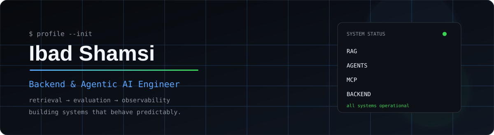

<div align="center">

<picture>
  <source media="(prefers-color-scheme: dark)" srcset="./assets/hero-dark.svg">
  <source media="(prefers-color-scheme: light)" srcset="./assets/hero-light.svg">
  
</picture>

<br>

<a href="https://forklift22.vercel.app">
  
</a>
<a href="mailto:forklift027@gmail.com">
  
</a>
<a href="https://pypi.org/project/mcp-drifter/">
  
</a>

</div>

<br>

<table>
<tr>
<td width="60%" valign="top">

I build systems that do work on their own, then obsess over the engineering underneath them: **retrieval quality, agent orchestration, evaluation, observability and failure modes.**

> I care less about making an agent look intelligent than making it behave predictably.

Currently exploring `RAG` · `MCP` · `agent systems` · `graph retrieval` · `voice agents`

</td>

<td width="40%" valign="top">

```text
build → measure → break
  ↑                  ↓
repeat ← fix ← observe
```

**Reliable systems > impressive demos**

</td>
</tr>
</table>

---

## `// start here`

<table>
<tr>
<td width="50%" valign="top">

### `01 /` [`DOCIFY`](https://github.com/Tunasmelt/Docify)

**Multi-tenant SaaS for document Q&A**

Three-tier OCR fallback, provider-partitioned RRF hybrid retrieval, SSE streaming responses.

`Next.js 14` `FastAPI` `Supabase` `Voyage AI` `Gemini`

</td>

<td width="50%" valign="top">

### `02 /` [`REMINISCE`](https://github.com/Tunasmelt/Reminisce)

**AI context orchestration & idea synthesis**

Injects project context into a project-management integration; context can be shared across a team.

`Next.js 14` `SaaS`

</td>
</tr>

<tr>
<td width="50%" valign="top">

### `03 /` [`DRIFTER`](https://github.com/Tunasmelt/Drifter-MCP)

**Proxy-based regression harness for MCP tool schemas**

Sits on the MCP connection to record real tool-use trajectories, then mutates and replays the tool interface offline. Recording is solid; mutation and replay are experimental. [On PyPI](https://pypi.org/project/mcp-drifter/).

`Python` `PyPI` `MCP`

</td>

<td width="50%" valign="top">

### `04 /` [`STRUC.TXT`](https://github.com/Tunasmelt/Struc.txt)

**Structured notes from rough capture**

Turns spoken or pasted notes into structured records via LLM, pinned to a draggable corkboard. Custom templates, auto-tagging, action-item extraction, version history alongside the raw capture.

`LLM` `Corkboard UI`

</td>
</tr>
</table>

---

## `// recently shipped`

<sub>Auto-updated daily from my most recently pushed public repos.</sub>

<!-- recent:start -->
- [**Cachify**](https://github.com/Tunasmelt/Cachify)  
  <sub>Python · 2026-11-01</sub>
- [**TrustWright**](https://github.com/Tunasmelt/TrustWright) — Security for Agents  
  <sub>Python · 2026-10-29</sub>
- [**Unstale**](https://github.com/Tunasmelt/Unstale)  
  <sub>JavaScript · 2026-10-29</sub>
- [**Cerebro-2.0**](https://github.com/Tunasmelt/Cerebro-2.0) — A personal multimodal knowledge vault — hybrid RAG retrieval, a live brain graph, and a client-si...  
  <sub>Python · 2026-10-18</sub>
- [**Cerebro-Flutter**](https://github.com/Tunasmelt/Cerebro-Flutter) — Flutter mobile client for Cerebro, a chat-with-your-documents knowledge base  
  <sub>Dart · 2026-10-13</sub>
- [**Docify**](https://github.com/Tunasmelt/Docify) — Docify is a multi-tenant document Q&A app  
  <sub>Python · 2026-10-09</sub>
<!-- recent:end -->

---

## `// other builds`

| Project | What it is |
|---|---|
| [**TrustWright**](https://github.com/Tunasmelt/TrustWright) | Local, open-source stdio MCP server for evidence-scoped authentication assessment. Assesses source and returns an implementation recipe; never claims a project is secure. |
| [**Cachify**](https://github.com/Tunasmelt/Cachify) | Prompt cache gateway (`pcg`) for diagnosing cache busts and serving safe semantic cache hits. Python 3.12, `uv`, CI-gated with ruff, mypy and pytest. |
| [**Cerebro 2.0**](https://github.com/Tunasmelt/Cerebro-2.0) | Multimodal RAG app with a brain-graph visualization UI. FastAPI + Next.js 15 + Supabase, `halfvec(1024)` embeddings, sealed-file tier with client-side WebCrypto key derivation. Has a [Flutter mobile client](https://github.com/Tunasmelt/Cerebro-Flutter). |
| [**Manifest**](https://github.com/Tunasmelt/Manifest-v2) | Note/story/novel sharing platform. Next.js 15 + Expo monorepo on Supabase, pure-TypeScript layout engine (86 tests), asset upload pipeline. |
| **ForkedRap** *(private)* | AI social media automation pipeline for hip-hop content. Fetch pipeline with a human review gate, schema-first mapping compiler emitting deterministic versioned artifacts with zero LLM calls on the happy path. Exposed as an MCP server. |
| [**Agent-OS**](https://github.com/Tunasmelt/Agent-OS) | Framework for structuring and controlling AI coding agents. Stack-agnostic config, tiered memory, gated phase pipeline (spec → design → plan → TDD → review → PR). |
| [**BeatLab**](https://github.com/Tunasmelt/BeatLab) | Browser-native beat maker on the Web Audio API. Sub-5ms scheduler drift, piano roll, swing and per-step velocity, WAV export via `OfflineAudioContext`, share-by-URL encoding. |
| [**NOIR: Transit**](https://github.com/Tunasmelt/Noir-Transit) | First-person psychological horror game in the browser, PS2-era aesthetic. Procedural audio one-shots, zone-based ambient scheduling, headless pixel-measurement rig for render verification. |

<details>
<summary><b>Data & ML archive</b></summary>

<br>

| Project | What it demonstrates |
|---|---|
| **Liver Segmentation & Tumor Analysis** | U-Net family models for CT segmentation with segmentation-based evaluation. |
| **Cart Abandonment Analysis** | SQL + Python + Power BI analysis of 5,000 sessions and modeled recovery opportunities. |
| **Carbon Emission Analysis** | Raw CSV → analysis → Power BI dashboard across 142 countries. |

</details>

---

## `// stack`

<div align="center">


</div>

---

## `// telemetry`

<div align="center">


<br>

<picture>
  <source media="(prefers-color-scheme: dark)" srcset="https://raw.githubusercontent.com/Tunasmelt/Tunasmelt/output/github-contribution-grid-snake-dark.svg">
  <source media="(prefers-color-scheme: light)" srcset="https://raw.githubusercontent.com/Tunasmelt/Tunasmelt/output/github-contribution-grid-snake.svg">
  
</picture>

</div>
