

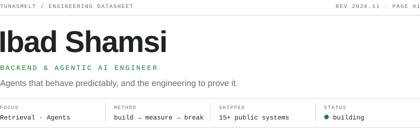

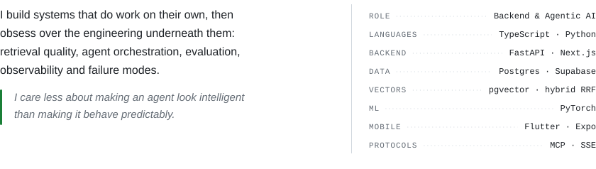

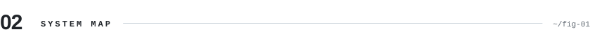

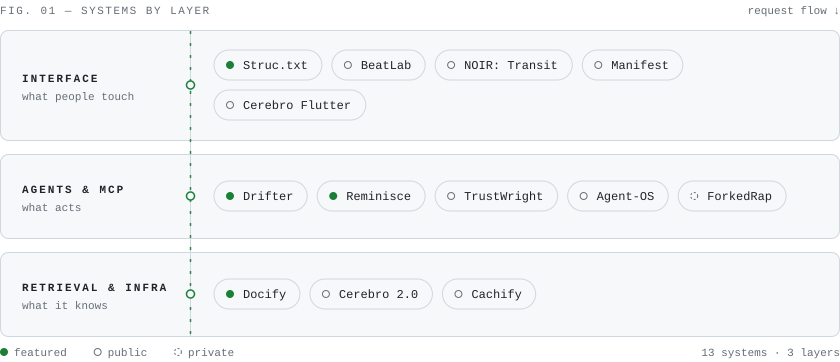

<a href="https://github.com/Tunasmelt/Docify">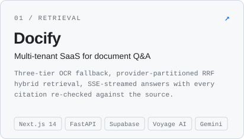</a>
<a href="https://github.com/Tunasmelt/Reminisce">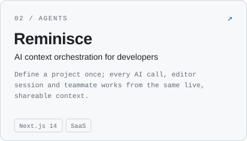</a>

<a href="https://github.com/Tunasmelt/Drifter-MCP">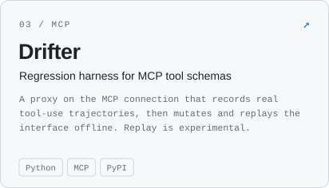</a>
<a href="https://github.com/Tunasmelt/Struc.txt">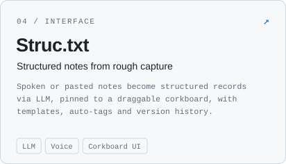</a>

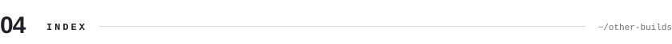

<a href="https://github.com/Tunasmelt/TrustWright">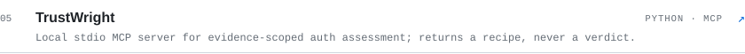</a>
<a href="https://github.com/Tunasmelt/Cachify">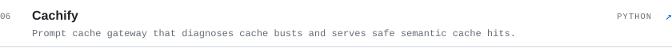</a>
<a href="https://github.com/Tunasmelt/Cerebro-2.0">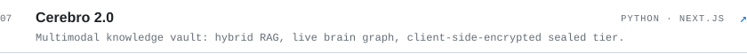</a>

<a href="https://github.com/Tunasmelt/Manifest-v2">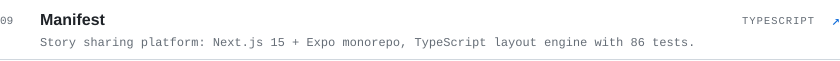</a>
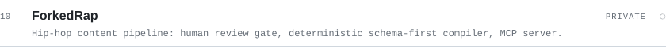

<a href="https://github.com/Tunasmelt/BeatLab">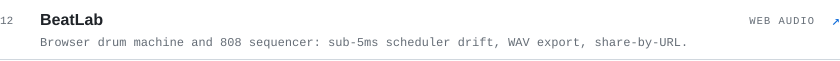</a>
<a href="https://github.com/Tunasmelt/Noir-Transit">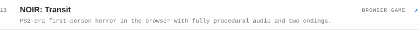</a>

<samp>DATA &amp; ML ARCHIVE · 3 EARLIER PROJECTS</samp>

 

<a href="https://github.com/Tunasmelt/Cart-Abandonment-Analysis">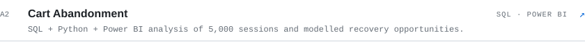</a>
<a href="https://github.com/Tunasmelt/Carbon-Emisisions-Analysis">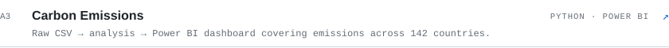</a>

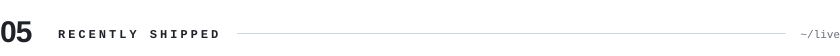

<samp>AUTO-UPDATED DAILY FROM MY MOST RECENTLY PUSHED PUBLIC REPOS</samp>

<!-- recent:start -->
<a href="https://github.com/Tunasmelt/Drifter-MCP">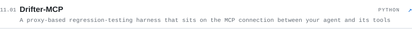</a>
<a href="https://github.com/Tunasmelt/Unstale">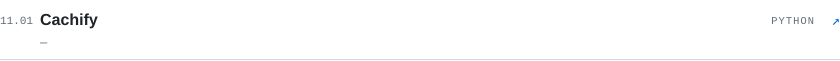</a>

<a href="https://github.com/Tunasmelt/Cerebro-Flutter">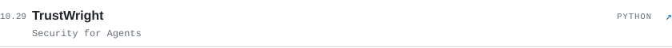</a>
<!-- recent:end -->

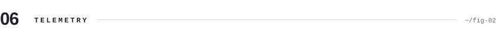

<picture><source media="(prefers-color-scheme: dark)" srcset="https://raw.githubusercontent.com/Tunasmelt/Tunasmelt/output/github-contribution-grid-snake-dark.svg"/></picture>

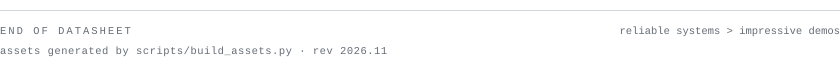
