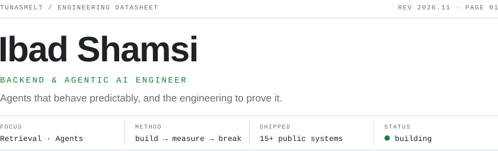
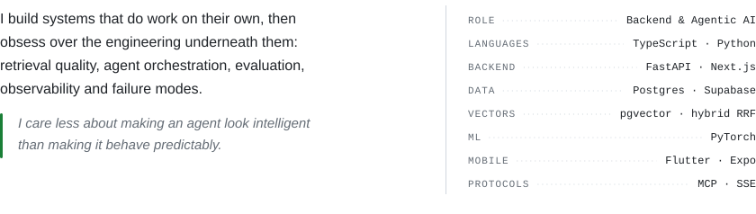
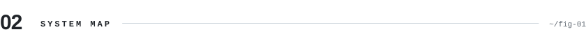
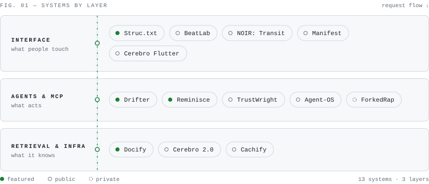
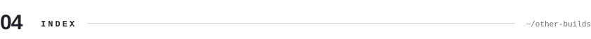
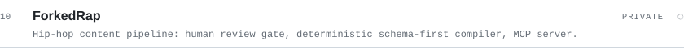
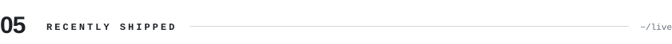
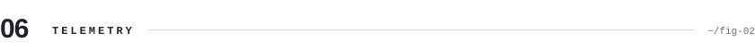
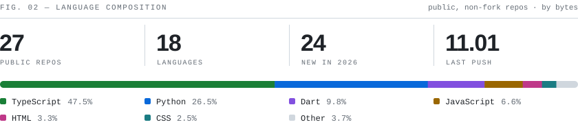
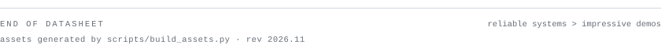

<picture><source media="(prefers-color-scheme: dark)" srcset="assets/dark/header.svg"/></picture>

<picture><source media="(prefers-color-scheme: dark)" srcset="assets/dark/s01.svg"/></picture>

<picture><source media="(prefers-color-scheme: dark)" srcset="assets/dark/about.svg"/></picture>

<picture><source media="(prefers-color-scheme: dark)" srcset="assets/dark/s02.svg"/></picture>

<picture><source media="(prefers-color-scheme: dark)" srcset="assets/dark/fig-01.svg"/></picture>

<picture><source media="(prefers-color-scheme: dark)" srcset="assets/dark/s03.svg"/></picture>

<picture><source media="(prefers-color-scheme: dark)" srcset="assets/dark/s04.svg"/></picture>

<picture><source media="(prefers-color-scheme: dark)" srcset="assets/dark/idx-forkedrap.svg"/></picture>

DATA &amp; ML ARCHIVE

| Project | What it demonstrates |
|---|---|
| **Liver Segmentation & Tumor Analysis** | U-Net family models for CT segmentation with segmentation-based evaluation. |
| **Cart Abandonment Analysis** | SQL + Python + Power BI analysis of 5,000 sessions and modeled recovery opportunities. |
| **Carbon Emission Analysis** | Raw CSV → analysis → Power BI dashboard across 142 countries. |

<picture><source media="(prefers-color-scheme: dark)" srcset="assets/dark/s05.svg"/></picture>

Auto-updated daily from my most recently pushed public repos.

<!-- recent:start -->

<!-- recent:end -->

<picture><source media="(prefers-color-scheme: dark)" srcset="assets/dark/s06.svg"/></picture>

<picture><source media="(prefers-color-scheme: dark)" srcset="assets/dark/telemetry.svg"/></picture>

<picture><source media="(prefers-color-scheme: dark)" srcset="https://raw.githubusercontent.com/Tunasmelt/Tunasmelt/output/github-contribution-grid-snake-dark.svg"/></picture>

<picture><source media="(prefers-color-scheme: dark)" srcset="assets/dark/colophon.svg"/></picture>
